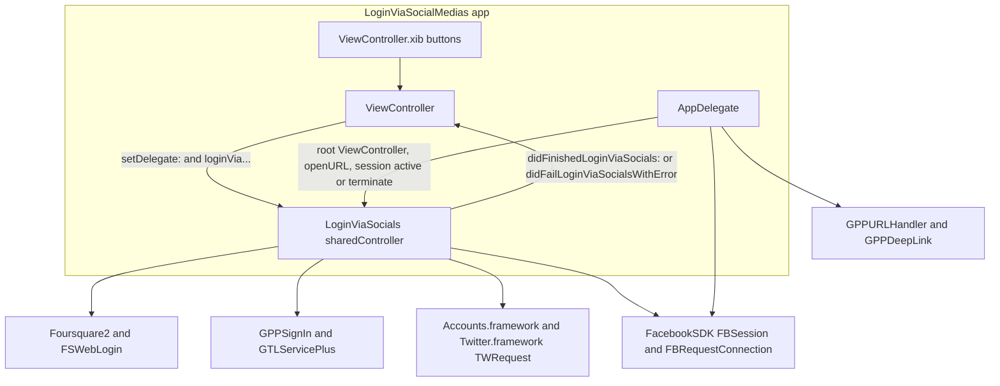
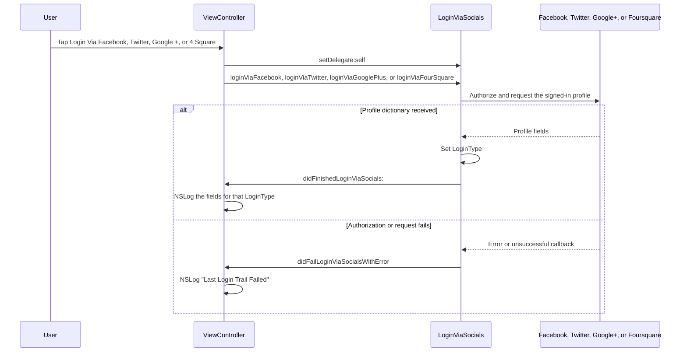

# LoginViaSocialMedias

[](https://github.com/aryansbtloe/LoginViaSocialMedias)
[](https://github.com/aryansbtloe/LoginViaSocialMedias)
[](https://github.com/aryansbtloe/LoginViaSocialMedias)
[](LICENSE)

Example Xcode project that adds Facebook, Twitter, Google+, and Foursquare login to an iOS app. One singleton, `LoginViaSocials`, runs each login and returns a profile dictionary through `LoginViaSocialsOperationDelegate`. The sample screen is a `ViewController` with four buttons.

The project was created in May 2013. The Xcode project organization name is Konstant Info Private Limited, and the application sources named below keep that company's 2013 copyright header. Vendored Facebook, Google, and Foursquare code keeps its own licenses. See [License](#license).

## Features

- Facebook login through the vendored Facebook iOS SDK. `loginViaFacebook` opens `FBSession` (with the login UI allowed) and, when the session is open, requests the Graph path `me` with the fields `picture`, `id`, `birthday`, `email`, `name`, `gender`, and `username`. If the session does not already include `read_stream`, it calls `reauthorizeWithReadPermissions:` for that permission before the request. The result dictionary gets `LoginType` = `Facebook`.
- Twitter login through the iOS `Accounts` and `Twitter` frameworks. The code asks for access to `ACAccountTypeIdentifierTwitter`, takes the first account, and sends a `TWRequest` `GET` to `https://api.twitter.com/1/users/show.json` with `screen_name`. The result gets `LoginType` = `Twitter`.
- Google+ login through `GPPSignIn` and `GTLServicePlus`. `loginViaGooglePlus` sets the client id, asks for the user's email and id, requests the moment action types listed in [Configuration](#configuration), and calls `authenticate`. `finishedWithAuth:error:` then runs `GTLQueryPlus queryForPeopleGetWithUserId:@"me"` and returns `email`, `googleID`, `name`, `username`, `gender`, and `LoginType` = `GooglePlus`.
- Foursquare login through the vendored `Foursquare2` client. If `isAuthorized` is true it loads the user `"self"`. Otherwise it presents `FSWebLogin` at `https://foursquare.com/oauth2/authenticate` with `response_type=token` and the redirect URL from `Foursquare2.h`. The profile dictionary uses `email`, `fourSquareID`, `name`, `username`, `gender`, and `LoginType` = `FourSquare`.
- `logOut` removes the Foursquare access token, closes `FBSession.activeSession` when one exists, and calls `[[GPPSignIn sharedInstance] signOut]`.
- Optional delegate callbacks: `didFinishedLoginViaSocials:` and `didFailLoginViaSocialsWithError`.
- `AppDelegate` installs the root `ViewController`, sets the Google+ client id, reads a Google+ deep link after install, forwards `application:openURL:sourceApplication:annotation:` to `FBSession` and `GPPURLHandler`, calls `[FBSession.activeSession handleDidBecomeActive]` when the app becomes active, and closes the Facebook session on terminate.

The sample `ViewController` logs the fields above. It does not create an account or send the profile anywhere else.

## Architecture

`ViewController` is the only screen. It sets itself as the `LoginViaSocials` delegate and calls one login method per button. `LoginViaSocials` is a `dispatch_once` singleton (`sharedController`); `+alloc` asserts if a second instance is created. `AppDelegate` owns the `UIWindow`, the Facebook session lifecycle hooks, and Google+ URL handling.



## Login flow

Each button in `ViewController.xib` is wired to an `IBAction` that sets the delegate and starts one provider. Success and failure both come back on `LoginViaSocialsOperationDelegate`. Facebook errors also show a `UIAlertView`. Twitter uses the account already stored in the device Settings app. Google+ and Facebook return through `application:openURL:sourceApplication:annotation:`. Foursquare presents its own web login controller.



`didFinishedLoginViaSocials:` runs only on the success paths in `LoginViaSocials.m`. For Facebook, that is when the Graph result is an `NSDictionary`. For Twitter, that is when account access is granted and the account store returns at least one account (the code uses the account at index 0). For Google+, that is when `finishedWithAuth:error:` gets a nil error and the people query succeeds. For Foursquare, that is when `getDetailForUser:@"self"` reports success. `didFailLoginViaSocialsWithError` is sent for a Facebook session or reauthorize error, a denied Twitter account request, and a failed Foursquare authorize or user fetch.

## Requirements

- macOS with Xcode. `LoginViaSocialMedias.xcodeproj` has `compatibilityVersion` `Xcode 3.2` and `LastUpgradeCheck` `0460` (the Xcode 4.6 project format).
- iOS SDK. The project deployment target is iOS 6.1 (`IPHONEOS_DEPLOYMENT_TARGET = 6.1`). `LoginViaSocialMedias-Prefix.pch` warns when the SDK is older than iOS 3.0.
- Device family iPhone and iPad (`TARGETED_DEVICE_FAMILY = 1,2`). `UIRequiredDeviceCapabilities` includes `armv7`.
- The app target compiles with ARC (`CLANG_ENABLE_OBJC_ARC = YES`). Every `Google Plus/OpenSource` `.m` file in the target is compiled with `-fno-objc-arc`.
- System frameworks and libraries linked by the `LoginViaSocialMedias` target: `UIKit`, `Foundation`, `CoreGraphics`, `Accounts`, `Social`, `Twitter`, `AdSupport`, `Security`, `SystemConfiguration`, and `libsqlite3.0.dylib`.
- The vendored binaries: `FaceBook/FacebookSDK.framework`, `Google Plus/lib/libGooglePlus.a`, and `Google Plus/lib/libGooglePlusUniversal.a`. `libGooglePlus.a` is a universal archive of `armv7` and `armv7s`.
- A Facebook app id, a Google+ OAuth client id, and a Foursquare client id and secret. The two `#error` lines described in [Configuration](#configuration) stop the build until they are edited.
- For Twitter, a Twitter account signed in under the device Settings app. The note in `I think u need some guidance.rtf` says the same thing. There is no Twitter source directory; `Twitter.framework` comes from the iOS SDK.

There is no CocoaPods `Podfile`, Carthage `Cartfile`, Swift Package Manager manifest, or other package-manager install.

## Installation

Clone the repository and open the Xcode project:

```bash
git clone https://github.com/aryansbtloe/LoginViaSocialMedias.git
cd LoginViaSocialMedias
open LoginViaSocialMedias.xcodeproj
```

Then, in Xcode:

1. Select the `LoginViaSocialMedias` target. The product name is `$(TARGET_NAME)`, so the app is `LoginViaSocialMedias.app`. `CFBundleShortVersionString` and `CFBundleVersion` are `1.0`.
2. Remove the `#error` lines and fill in the Google+ client id and the Foursquare client id and secret. See [Configuration](#configuration). Until those lines are removed, the target does not compile.
3. Replace the sample Facebook app id, bundle identifier, and URL types in `LoginViaSocialMedias/LoginViaSocialMedias-Info.plist`.
4. Set code signing to your own Apple Developer identity. Debug and Release currently store a `CODE_SIGN_IDENTITY` and `PROVISIONING_PROFILE` from the machine that created the project. Those values will not match a new checkout.
5. Build and run the `LoginViaSocialMedias` scheme on a device or simulator. The supported orientations are portrait, landscape left, and landscape right. The iPad set also includes portrait upside down.

Framework search paths include `$(SRCROOT)/FaceBook`. Library search paths include `$(SRCROOT)/Google Plus/lib`. The prefix header is `LoginViaSocialMedias/LoginViaSocialMedias-Prefix.pch`. The Info.plist is `LoginViaSocialMedias/LoginViaSocialMedias-Info.plist`.

## Usage

Adopt `LoginViaSocialsOperationDelegate`, keep a `LoginViaSocials` delegate, and call the login method you want. This is the sample controller:

```objc
#import "ViewController.h"

@interface ViewController ()

@end

@implementation ViewController

-(IBAction)loginViaFacebook:(id)sender
{
    [[LoginViaSocials sharedController] setDelegate:self];
    [[LoginViaSocials sharedController] loginViaFacebook];
}

-(IBAction)loginViaTwitter:(id)sender
{
    [[LoginViaSocials sharedController] setDelegate:self];
    [[LoginViaSocials sharedController] loginViaTwitter];
}

-(IBAction)loginViaGooglePlus:(id)sender
{
    [[LoginViaSocials sharedController] setDelegate:self];
    [[LoginViaSocials sharedController] loginViaGooglePlus];
}

-(IBAction)loginViaFourSquare:(id)sender
{
    [[LoginViaSocials sharedController] setDelegate:self];
    [[LoginViaSocials sharedController] loginViaFourSquare];
}
```

The public interface is `LoginViaSocials`:

```objc
@protocol LoginViaSocialsOperationDelegate <NSObject>
@optional
-(void)didFinishedLoginViaSocials:(NSMutableDictionary *)results;
-(void)didFailLoginViaSocialsWithError;
@end

@interface LoginViaSocials : NSObject
{
    id caller;
}

@property(nonatomic,retain)id caller;

+(LoginViaSocials*)sharedController;
-(void)setDelegate:(id)caller;

-(void)loginViaFacebook;
-(void)loginViaTwitter;
-(void)loginViaGooglePlus;
-(void)loginViaFourSquare;
-(void)logOut;

@end
```

`ViewController` reads `LoginType` and logs the profile. The keys below are the ones that method uses.

| `LoginType` | Keys read in `ViewController.m` |
| --- | --- |
| `Facebook` | `id`, `email`, `name`, `username`, `gender` |
| `GooglePlus` | `googleID`, `name`, `username`, `email`, `gender` |
| `Twitter` | `id`, `name`, `screen_name`, `email`, `gender`, `location`, `profile_image_url` |
| `FourSquare` | `fourSquareID`, `name`, `username`, `email`, `gender` |

Facebook Graph fields also include `picture` and `birthday`. The sample controller does not log those two. Twitter `email` and `gender` are read from the `users/show.json` payload; the request itself only sends `screen_name`.

Failure logging from the sample:

```objc
-(void)didFailLoginViaSocialsWithError
{
    NSLog(@"Last Login Trail Failed");
}
```

Sign-out:

```objc
-(void)logOut
{
    //log out from four square
    [Foursquare2 removeAccessToken];

    //log out from facebook
    if (FBSession.activeSession)
        [FBSession.activeSession close];

    //log out from google plus
    [[GPPSignIn sharedInstance]signOut];
}
```

`AppDelegate` forwards return URLs. Facebook handling runs when `FBSession.activeSession` is non-nil. The method's return value is the `GPPURLHandler` result:

```objc
- (BOOL)application:(UIApplication *)application openURL:(NSURL *)url sourceApplication:(NSString *)sourceApplication annotation:(id)annotation
{
    if (FBSession.activeSession)
        [FBSession.activeSession handleOpenURL:url];
    return [GPPURLHandler handleURL:url
                  sourceApplication:sourceApplication
                         annotation:annotation];
}
```

`AppDelegate` also implements `openSessionWithAllowLoginUI:`, which requests `email`, `user_likes`, and `user_birthday`, and posts `com.example.Login:FBSessionStateChangedNotification`. The four buttons do not call that method. They call `LoginViaSocials`, which opens the Facebook session with `readPermissions:nil` and then reauthorizes `read_stream`.

The nib buttons are titled `Login Via Facebook`, `Login Via Twitter`, `Login Via Google +`, and `Login Via 4 Square`.

## Project structure

```
.
├── LoginViaSocialMedias.xcodeproj/     Xcode project (one application target)
├── LoginViaSocials.h                   Singleton interface, provider imports, Google+ client-id macro
├── LoginViaSocials.m                   Facebook, Twitter, Google+, and Foursquare login and logOut
├── LoginViaSocialMedias/
│   ├── AppDelegate.h
│   ├── AppDelegate.m                   Window, Facebook session hooks, Google+ URL and deep link
│   ├── ViewController.h
│   ├── ViewController.m                Button actions and NSLog of profile fields
│   ├── ViewController.xib              Four login buttons
│   ├── main.m
│   ├── LoginViaSocialMedias-Info.plist Bundle id, FacebookAppID, URL types
│   ├── LoginViaSocialMedias-Prefix.pch
│   ├── en.lproj/InfoPlist.strings
│   ├── Default.png
│   ├── Default@2x.png
│   ├── Default-568h@2x.png
│   └── FaceBook/                       Second copy of the Facebook SDK framework and resource bundles
├── FaceBook/                           Facebook SDK linked by the target
│   ├── FacebookSDK.framework
│   ├── FacebookSDKResources.bundle
│   └── FBUserSettingsViewResources.bundle
├── Google Plus/
│   ├── lib/                            GPP*.h, libGooglePlus.a, libGooglePlusUniversal.a
│   ├── OpenSource/                     GTL, GTM, GTMOAuth2, OpenInChromeController
│   └── Resources/                      Localized Google+ SDK resources (.lproj)
├── Four square/                        Foursquare2, FSRequester, FSTargetCallback, FSWebLogin, images
├── I think u need some guidance.rtf    Setup note copied into the app resources
├── README.md
└── LICENSE
```

`LoginViaSocials.h` and `LoginViaSocials.m` live at the repository root. Their Xcode file references use `sourceTree = SOURCE_ROOT`. The Xcode group named Twitter only contains `Twitter.framework` from the iOS SDK.

`I think u need some guidance.rtf` is included in the target's Copy Bundle Resources phase. It says to sign in to Twitter from the device Settings app, to put the Facebook app id in the application Info.plist (`FacebookAppID`, with the sample value `123456789`), and to edit the target URL types. The note is signed Alok Kumar Singh.

## Configuration

Use your own credentials. The values below are placeholders or the sample strings already checked in. Do not commit a live client secret.

### Facebook

`LoginViaSocialMedias/LoginViaSocialMedias-Info.plist` currently contains the sample app id `123456789` under `FacebookAppID`, and these URL types under `CFBundleURLTypes`:

- URL name: the bundle identifier (`CFBundleIdentifier` is `com.kipl.saurabhtest1`)
- URL schemes: `fb123456789` and `com.kipl.saurabhtest1`

Replace them with your app's values:

```xml
<key>CFBundleIdentifier</key>
<string>YOUR_BUNDLE_ID</string>
<key>CFBundleURLTypes</key>
<array>
    <dict>
        <key>CFBundleTypeRole</key>
        <string>Editor</string>
        <key>CFBundleURLName</key>
        <string>YOUR_BUNDLE_ID</string>
        <key>CFBundleURLSchemes</key>
        <array>
            <string>fbYOUR_FACEBOOK_APP_ID</string>
            <string>YOUR_BUNDLE_ID</string>
        </array>
    </dict>
</array>
<key>FacebookAppID</key>
<string>YOUR_FACEBOOK_APP_ID</string>
```

`LoginViaSocials.h` imports the SDK with this path from the repository root:

```objc
#import "FaceBook/FacebookSDK.framework/Headers/FacebookSDK.h"
```

### Google+

`LoginViaSocials.h` stops the build on this macro. The string there is a placeholder. Remove the `#error` and set your client id:

```objc
#error "please put your google plus client id here"
#define kClientID  @"123456789.apps.googleusercontent.com";
```

`loginViaGooglePlus` assigns that macro:

```objc
GPPSignIn *signIn = [GPPSignIn sharedInstance];
signIn.clientID = kClientID;
signIn.delegate = self;
signIn.shouldFetchGoogleUserEmail = YES;
signIn.shouldFetchGoogleUserID = YES;
signIn.shouldGroupAccessibilityChildren = YES;
signIn.actions = [NSArray arrayWithObjects:
                  @"http://schemas.google.com/AddActivity",
                  @"http://schemas.google.com/BuyActivity",
                  @"http://schemas.google.com/CheckInActivity",
                  @"http://schemas.google.com/CommentActivity",
                  @"http://schemas.google.com/CreateActivity",
                  @"http://schemas.google.com/ListenActivity",
                  @"http://schemas.google.com/ReserveActivity",
                  @"http://schemas.google.com/ReviewActivity",
                  nil];

[signIn authenticate];
```

`AppDelegate` `initializeGooglePlus` also assigns `[GPPSignIn sharedInstance].clientID` to a client-id literal, then calls `[GPPDeepLink setDelegate:self]` and `[GPPDeepLink readDeepLinkAfterInstall]`. Replace that literal with your own client id (`YOUR_CLIENT_ID.apps.googleusercontent.com`). `didReceiveDeepLink:` in `AppDelegate` is empty.

`LoginViaSocials` implements `finishedWithAuth:error:` and uses it as the `GPPSignIn` delegate callback. The class interface does not declare `GPPSignInDelegate`.

### Foursquare

`Four square/Foursquare2.h` stops the build until the client id and secret are filled in. The checked-in values are blank placeholders:

```objc
#error "please fill the following information below"
#define OAUTH_KEY    (@"________________________________________________")
#define OAUTH_SECRET (@"________________________________________________")

//2, don't forget to added app url in your info plist file CFBundleURLTypes
#define REDIRECT_URL @"myapp://connect"

//3 update this date to use up-to-date Foursquare API
#define VERSION (@"20130117")

#define kBaseUrl @"https://api.foursquare.com/v2/"
```

Set `OAUTH_KEY` and `OAUTH_SECRET` to your Foursquare client id and secret, and set `REDIRECT_URL` to a URL your app handles. The header comment says to add that URL in `CFBundleURLTypes`. The checked-in Info.plist schemes are the Facebook scheme and the bundle identifier. They do not include `myapp`.

`authorizeWithCallback:` builds:

```text
https://foursquare.com/oauth2/authenticate?client_id=OAUTH_KEY&response_type=token&redirect_uri=REDIRECT_URL
```

It presents `FSWebLogin` inside a `UINavigationController` from the window's top view controller.

### Twitter

No API key is defined in this project. Sign in to Twitter in the iOS Settings app before tapping **Login Via Twitter**. The request URL is built as:

```objc
NSURL * url = [NSURL URLWithString:[@"https://api.twitter.com/1/" stringByAppendingString:@"users/show.json"]];
```

## Contributing

Issues and pull requests go to [github.com/aryansbtloe/LoginViaSocialMedias](https://github.com/aryansbtloe/LoginViaSocialMedias). The default branch is `master`.

- Keep changes to the application sources in the style already used there: Objective-C, the `LoginViaSocials` singleton, and the delegate methods `didFinishedLoginViaSocials:` and `didFailLoginViaSocialsWithError`.
- Leave third-party files under `FaceBook/`, `LoginViaSocialMedias/FaceBook/`, `Google Plus/`, and `Four square/` under their existing copyright headers. Do not move them onto the MIT license.
- Leave the `Copyright (c) 2013 Konstant Info Private Limited` headers on the application sources that already have them.
- Do not commit live API keys, client secrets, or provisioning profiles. The Google+ and Foursquare slots are placeholders on purpose.
- The project has no test target and no continuous-integration workflow. Build the `LoginViaSocialMedias` target in Xcode after a change.

## License

A `LICENSE` file was added with the MIT License, Copyright (c) 2026 Alok Singh. That grant covers original work of Alok Singh in this repository that does not already carry another copyright or license. It does not relicense the rest of the tree.

These parts keep their own notices:

| Path | Notice in the tree |
| --- | --- |
| `LoginViaSocials.h`, `LoginViaSocials.m`, `LoginViaSocialMedias/AppDelegate.h`, `LoginViaSocialMedias/AppDelegate.m`, `LoginViaSocialMedias/ViewController.h`, `LoginViaSocialMedias/ViewController.m`, `LoginViaSocialMedias/main.m` | Created by Alok (7 May 2013 or 8 May 2013). `Copyright (c) 2013 Konstant Info Private Limited. All rights reserved.` |
| `FaceBook/` and `LoginViaSocialMedias/FaceBook/` | Facebook iOS SDK. Copyright 2010 or 2012 Facebook. Apache License, Version 2.0. `FacebookSDK.h` says `Copyright 2012`. `FBOpenGraphAction.h` links to `http://www.apache.org/xlicenses/LICENSE-2.0`; the other headers link to `http://www.apache.org/licenses/LICENSE-2.0`. |
| `Google Plus/lib/` | Google+ iOS SDK. Copyright 2012 Google Inc. (`GPPURLHandler.h` is Copyright 2013 Google Inc.). Use is subject to the Google+ Platform Terms of Service, `https://developers.google.com/+/terms`. Includes `libGooglePlus.a` and `libGooglePlusUniversal.a`. |
| `Google Plus/OpenSource/` except `OpenInChromeController.*` | Copyright Google Inc. Apache License, Version 2.0. This is the Google Toolbox for Mac, GTL (including `GTLPlus`), and GTMOAuth2 sources compiled into the app. |
| `Google Plus/OpenSource/OpenInChromeController.h` and `.m` | Copyright 2012 Google Inc. BSD-style redistribution terms are in the file header. |
| `Four square/Foursquare2.h` and `Foursquare2.m` | Created by Constantine Fry on 1/7/11. Copyright 2011 Home. All rights reserved. |
| `Four square/FSWebLogin.h` and `FSWebLogin.m` | Created by Constantine Fry on 12/20/10. Copyright 2010 Home. All rights reserved. |
| `Four square/FSRequester.*` and `Four square/FSTargetCallback.*` | No copyright header. They are part of the same vendored Foursquare client. |

The Xcode project attribute `ORGANIZATIONNAME` is `Konstant Info Private Limited`.

## Author

Alok Singh

- GitHub: [https://github.com/aryansbtloe](https://github.com/aryansbtloe)
- Website: [https://bestlatestapps.com](https://bestlatestapps.com)

The application sources are marked Created by Alok on 7 May 2013 (`AppDelegate`, `ViewController`, `main.m`) and 8 May 2013 (`LoginViaSocials`). The setup note `I think u need some guidance.rtf` is signed Alok Kumar Singh.
